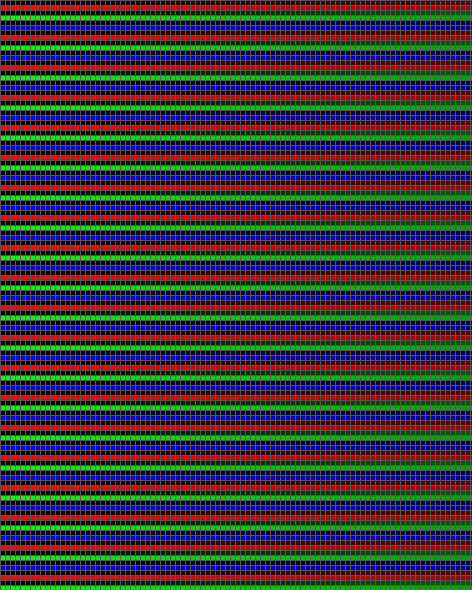

# libsane

[](https://crates.io/crates/libsane)
[](https://docs.rs/libsane)
[](https://github.com/AlixANNERAUD/libsane_rust/actions/workflows/ci.yml)

**Scan documents and images from Rust.** Safe, idiomatic bindings to
[SANE](http://www.sane-project.org/) (Scanner Access Now Easy), the scanner
API of Linux, the BSDs and macOS: find flatbed scanners, document feeders and
multifunction printers, set the resolution, mode and scan area, and get the
page as raw bytes or as an [`image`](https://crates.io/crates/image) ready to
save or to feed to OCR.

```rust
use libsane::{Sane, well_known};

let sane = Sane::init()?;
for device in sane.devices(false)? {
    println!("{}: {} {} ({})", device.name, device.vendor, device.model, device.kind);
}

let mut scanner = sane.open("test:0")?;
scanner.set_value(well_known::MODE, well_known::MODE_COLOR)?;
scanner.set_value(well_known::RESOLUTION, 300)?;  // dpi
scanner.scan()?.to_image()?.save("page.png")?;    // `image` feature
```

<p align="center">
  
</p>

## Features

- **Every SANE scanner**: USB and network scanners and multifunction printers
  supported by sane-backends, including driverless eSCL/AirScan devices with
  `sane-airscan`.
- **Safe by construction**: one initialization per process, devices closed
  before `sane_exit`, buffers sized from the option descriptors; `unsafe` code
  is confined to one module of small, documented functions.
- **Typed options**: bool, int, fixed-point, string and button options, with
  constraints (range, word list, string list) and capabilities; the option
  list reloads itself on `SANE_INFO_RELOAD_OPTIONS`.
- **Every way to read a scan**: chunks through `std::io::Read`, a whole
  `Frame` of raw bytes and parameters, or an `image::DynamicImage` (`image`
  feature). Gray, RGB, 1/8/16-bit, three-pass and hand scanners, and document
  feeders page after page.
- **Typed errors**: every `SANE_Status` maps to an `Error` variant (`Jammed`,
  `NoDocs`, `CoverOpen`...); no panic crosses the FFI boundary.

The API is blocking: from async code, run the SANE session on a blocking
thread, for example with `tokio::task::spawn_blocking`.

## System requirements

libsane and its development files, pkg-config and libclang:

| System | Command |
| --- | --- |
| Debian, Ubuntu | `sudo apt install libsane-dev pkg-config libclang-dev` |
| Fedora | `sudo dnf install sane-backends-devel pkgconf-pkg-config clang-devel` |
| Arch Linux | `sudo pacman -S sane pkgconf clang` |
| macOS (Homebrew) | `brew install sane-backends pkg-config llvm` |

**No scanner at hand?** SANE's `test` backend provides virtual devices
(`test:0`, `test:1`): uncomment `test` in `/etc/sane.d/dll.conf`, or point
`SANE_CONFIG_DIR` to a directory whose `dll.conf` lists it.

## License

Licensed under either of Apache License, Version 2.0 or MIT license at your
option.
